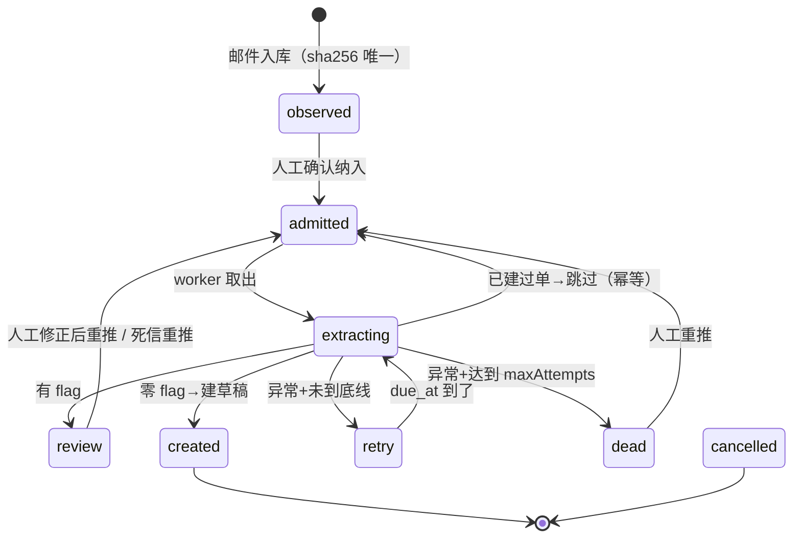

# fetchnow-email-to-draft-system · 整体实现架构（#541 阶段一）

> 目的：邮件收票 → 观察池 → 人工纳入 → 自动提取与自校验 → 建 Xero **账单草稿**。
> 一句话原则：**机器负责收、负责抄、负责挑毛病；签字权永远在人手里，终态永远是 DRAFT。**

## 0. 这份文档和 `PLAN.md` 怎么分工

| 文档 | 回答的问题 |
| --- | --- |
| `PLAN.md` | 「要注意什么」：37 条踩坑清单、配置速查、分阶段路线 |
| `ARCHITECTURE.md`（本文） | 「系统怎么跑」：分层、状态机、验收用例为什么长这样、收件层为什么这么摆 |
| `README.md` | 入口：三分钟跑起来 + 文档索引 |

本文主线是**整体实现架构**，往下钻的三处细节单独成章，各自讲透：

- 第 3 章 **状态机**（八个状态、迁移表、为什么是这个形状）
- 第 4 章 **四条验收用例**（每个用例的输入、期望、断言、在防哪类事故）
- 第 5 章 **IMAP 与 IDLE**（IDLE 到底是什么、为什么阶段一先关、怎么开）

## 1. 边界

**做**：邮件收票、落盘、观察池、人工确认纳入、字段提取、规则自校验、建 draft bill、事件流。
**不做（阶段一）**：真 Xero OAuth、PO 匹配、付款、GL 编码、OCR、登录鉴权、Web 服务。

阶段一的收件源是本地目录 `fixtures/inbox/*.eml`（离线可重复），交付端是 `MockXeroAdapter`——**跟真 Xero 一行代码都没关系**，只用来证明「收票 → 建草稿」这条链路和状态机能跑通。真接口替换点是 `src/xero.ts` 的 `createAdapter()`，收件层、状态机、验收用例都不用改。

## 2. 整体架构

### 2.1 分层

```
┌─ 收件层 ingest.ts ───────────────────────────────────────────┐
│  folder 源 / imap 源  →  信封解析 → 过滤 → 附件落盘           │
│  幂等键1：messages.message_id（Message-ID）                    │
└────────────────────────────┬─────────────────────────────────┘
                             │ 每个 PDF = 一条发票任务
┌─ 任务层 db.ts ─────────────▼─────────────────────────────────┐
│  invoices（status 驱动，sha256 唯一）＋ events（流水）        │
└────────────────────────────┬─────────────────────────────────┘
                             │ 人工确认后才放行
┌─ 处理层 pipeline.ts ───────▼─────────────────────────────────┐
│  串行 worker：extract → validate → 建草稿 / 转人工 / 重试     │
└────────────────────────────┬─────────────────────────────────┘
                             │
┌─ 交付层 xero.ts ───────────▼─────────────────────────────────┐
│  MockXeroAdapter（写 JSON）｜XeroApiAdapter（POST /Invoices） │
└──────────────────────────────────────────────────────────────┘
```

要点：**收件只入库不处理，处理只消费数据库**。中间那层 sqlite 是唯一的交接方式，所以进程重启、手工改库、面板点了按钮，行为都可预期——这也是四个面板能各自独立读同一份数据的原因。

### 2.2 模块

| 模块 | 职责 | 对外接口 |
| --- | --- | --- |
| `src/config.ts` | 读 `config/default.json` + 环境变量覆盖 + 路径解析 | `loadConfig(overrides)` / `resolvePaths(cfg)` |
| `src/db.ts` | schema、幂等 upsert、事件流 | `open` / `insertMessage` / `createInvoice` / `updateInvoice` / `dueInvoices` / `recordEvent` |
| `src/ingest.ts` | 两路收件源、过滤、附件落盘、建任务 | `runIngest` / `ingestOnce` |
| `src/extract.ts` | 判版式 → 分流到中文模板或英文正则，出口统一成 `InvoiceFields` | `extractInvoice(path, cfg)` |
| `src/extract-cn.ts` | 中文数电发票模板（见 §2.5） | `looksLikeCnEInvoice` / `extractCnInvoice` |
| `src/validate.ts` | 规则引擎 → `ReviewFlag[]` + 是否放行 | `validate(fields, cfg, ctx)` |
| `src/xero.ts` | 适配器：mock / 真 API 骨架 | `createAdapter(cfg)` |
| `src/pipeline.ts` | 编排：收件、纳入、串行处理、watchers | `ingestOnce` / `admitInvoice` / `processOnce` / `retryInvoice` / `startWatchers` |
| `src/cli.ts` | 人操作入口 | 命令清单见 §7 |

### 2.3 主线数据流

```
扫到一封邮件
  → messages 表查 Message-ID（已存在 ⇒ duplicates，收手）
  → 过滤：附件类型白名单 / 体积上限（不过滤 ⇒ filtered 表留痕）
  → 附件落盘 data/attachments/<sha16>-<filename>（同 hash 只写一次）
  → invoices 表按 sha256 建任务，status = observed（观察池）
  → 人在「待开票输入」面板点纳入 ⇒ admitted
  → worker 串行取 admitted：
       extract（文本层 → 字段）
       validate（金额自洽 / 税率 / 日期 / 重复发票号 / 置信度）
       零 flag ⇒ 建草稿 ⇒ created
       有 flag ⇒ review（面板标黄，等人）
       抛异常 ⇒ attempt_count+1 + 退避 ⇒ retry，超 maxAttempts ⇒ dead
```

### 2.4 与四个面板的映射

| 面板 | 读什么 | 写什么 |
| --- | --- | --- |
| 待开票输入 | `status ∈ (observed, review)` 的任务 + `extracted` 快照 + `flags` | 确认纳入（`admit`）、标记复核结果 |
| 任务队列 | 全部任务 + `attempt_count` + `last_error` | 重推、`retry` |
| 队列操作 | 单条详情 | `admit` / `retry` / 取消（保留状态，不删数据） |
| 实时动态 | `events` 表倒序 | —（只读） |

### 2.5 识别是怎么做的（刻意不用 AI 模型）

 发票识别从来不是「把 PDF 丢给模型吐 JSON」。当前链路是三段：

1. **抽文本层** — `pdfjs-dist` 把 PDF 里内嵌的文字按坐标重组成行数组。
   文本层是好的 ⇒ `extraction = 'native'`；抽不出来（扫描件/图片型 PDF）⇒ `extraction = 'none'`。
2. **判版式分流** — `looksLikeCnEInvoice()` 看文本里有没有中文字段名（电子发票/增值税/发票号码）
   **并且**有没有人民币符号，两个条件同时成立才走中文模板。只凭中文说明文字会把含中文的英文账单误判进来。
3. **规则抽取** — 每个字段由一条规则定位，返回 `{ value, confidence, source }`，`source` 指回原图位置（如
   `native:sellerBlock`）出问题能翻回原票核对。

**什么时候才需要「模型」：PDF 抽不出文本层时，即真正的扫描件。** 那一步是 OCR，
`extract.ocrEnabled = false` 时直接落 `OCR_NEEDED` 转人工，而不是开个假 OCR 硬填数字。

刻意不用大模型的理由写在 validate.ts 的注释里：**模型说有 90% 把握本身不是质量保证**。
金额入账要的是「能复现、能指回原图、算不平就别过」，这三件事规则引擎比黑盒判断更靠得住，
而且成本是零 API 调用。

值得上 AI 的边界（将来想加再往这里加，别提前塞）：版式种类多到规则写不完、手写体、
以及拿模型对已有字段做交叉复核（注意复核失败也必须落成 flag，不能变成"模型说了算"）。

**中文数电发票为什么必须单独一套规则**：英文发票那套锚点是 `Total Amount Due` / `Subtotal` / `NZD`，
在数电发票上一处都不存在。它的文本行长这样（pdfjs 按 y 坐标合并后的真实样本，
见 `fixtures/samples/cn-einvoice-sample.pdf`）：

```
电子发票（普通发票） 发票号码：
开票日期：
名称： 名称：
26372000004880622631              ← 发票号码（固定 20 位数字）
2026年10月02日                    ← 开票日期
北京市中闻（深圳）律师事务所      ← 购买方名称
31440000MD0219667A                ← 购买方税号
开心小胖餐饮管理（济南）有限公司  ← 销售方名称（vendor）
91370104MA3RAQTFXH                ← 销售方税号
¥712.87 ¥7.13                     ← 合计（金额 / 税额）
柒佰贰拾圆整 ¥720.00               ← 价税合计（小写 = total）
*生产生活服务*餐饮服务 1%桌 712.87 7.13712.8712871287131   ← 明细
```

所以每条规则都挑**不依赖行列位置、只依赖内容特征**的锚点：

| 字段 | 锚点 | 为什么这样取 |
| --- | --- | --- |
| 发票号 | 全文第一个 20 位连续数字 | 数电发票号固定 20 位；比数「发票号码：」后面隔了几行稳得多（中间还夹着发票号和日期） |
| 开票日期 | `YYYY年M月D日` | 中文日期格式，转 ISO |
| 币种 | 有 `¥`/`￥` ⇒ `CNY` high | 比英文那套三字母码检测准，也不再 fallback 成 NZD |
| 金额小计 / 税 | 含两个以上 `¥` 的那一行，第一个是小计、第二个是税 | `¥712.87 ¥7.13` |
| 总额 | 全文最后一个 `¥` 金额 | `价税合计（小写）` 永远在最下面那行 |
| 供应商 | **最后一个 18 位税号的上一行** | 数电发票是左右双栏、卖方块排在买方块之后；靠这个位置关系取销售方，比去数「名称： 名称：」后第几行可靠 |
| 明细 | 行首 `*…*…` + 只认带小数点的数 | 八栏（项目/规格/单位/数量/单价/金额/税率/税额）全挤成一行，`1287131` 这种拼接整数靠「必须有小数点」自动出局 |

一条关键约束：**金额必须能算平** `712.87 + 7.13 = 720.00`，否则 validate 报 `AMOUNT_MISMATCH`。
中文模板测试里有一条专门卡这条（`test/extract-cn.test.ts`）。

税率白名单从 `allowedGstRates` 改名成 **`allowedTaxRates`**，因为现在它同时要比对
中国增值税（1%/3%/5%/6%/9%/13%）和澳洲 GST（5%/10%/15%）。改名时类型检查会把所有引用点揪出来。

## 3. 状态机（详细展开）

### 3.1 为什么需要状态机

发票任务不是「一条待办」，它是**跨多个人动作和一次外部写操作**的长生命周期对象：邮件可能来两次、解析可能崩、人可能点按钮、Xero 可能 429。用布尔标记（`is_parsed` + `is_sent`）表达不了「解析完了但还没发、人撤回了、发了但超时了待重试」这些组合，最后一定写出 `if (!a) { if (b) ... }` 的泥团。状态机把「现在能发生什么」收敛成一张表，面板和 CLI 都只是它的两种视图。

### 3.2 八个状态

| 状态 | 含义 | 谁写入 | 面板呈现 | 是不是终态 |
| --- | --- | --- | --- | --- |
| `observed` | 已收进观察池，**没被确认** | ingest | 待开票输入（灰：还没人点头） | 否 |
| `admitted` | 已确认纳入，在队列里等 worker | `admitInvoice`（人工）或 `autoAdmitTrusted`（白名单命中） | 待处理 + 任务队列 | 否 |

从 `observed → admitted` 这条边有**两个触发方**，这是阶段一唯一一处「机器替人做决定」的地方，
所以门禁画得很窄：只有发件人在 `review.autoAdmitDomains` 里才会被自动推进，其余一律等人点。
状态本身、后续所有流转都没变——`admitInvoice` 是同一个函数，自动/人工只是谁调它。
| `extracting` | 正在提取（串行 worker 内，窗口极短） | `processOnce` | 实时动态闪一下 | 否 |
| `review` | 有 flag，转人工复核 | `processOnce` | 待开票输入（**标黄** + 原因） | 否（可改字段后重推） |
| `retry` | 抛异常了，`due_at` 之后再来一次 | `processOnce` | 任务队列（红 + 错误信息） | 否 |
| `created` | 已建草稿，`provider_ref` 有值 | `processOnce` | 任务队列（已完成） | **是** |
| `dead` | 重试到上限，进死信 | `processOnce` | 任务队列（需人处理，可重推） | 否（可重推出死信） |
| `cancelled` | 人主动取消（保留现场，不删记录） | 预留 UI | 任务队列（灰） | **是** |

注意 `extracting` 是**瞬时态**：它存在的唯一意义是让「处理中」这件事在事件流里可见，以及防止并发 worker 把同一条任务重复取走（阶段一 `concurrency = 1`，这条是给阶段五留的）。

### 3.3 迁移表（含代码位置）

| from | to | 触发 | 代码位置 |
| --- | --- | --- | --- |
| （新邮件） | `observed` | ingest 落盘建任务 | `ingest.ts` `handleEnvelope` → `db.createInvoice` |
| `observed` | `admitted` | 人点「纳入」 | `pipeline.ts` `admitInvoice` |
| `admitted` / `retry` | `extracting` | worker 取出（写 `attempt_count + 1`） | `pipeline.ts` `processOnce` |
| `extracting` | `admitted` | **已建过单**（`provider_ref` 非空）→ 直接跳过，不重复 POST | `pipeline.ts` 结果层兜底分支 |
| `extracting` | `review` | 有 flag 或校验未通过 | `pipeline.ts` 转人工分支 |
| `extracting` | `created` | 零 flag → 适配器建草稿 | `pipeline.ts` 建单分支 |
| `extracting` | `retry` | 抛异常且 `attempt < maxAttempts` | `pipeline.ts` catch 分支 |
| `extracting` | `dead` | 抛异常且达到 `maxAttempts` | `pipeline.ts` catch 分支 |
| `retry` | `extracting` | `due_at <= now` 被 worker 取走 | `db.ts` `dueInvoices` 查询条件 |
| `review` / `dead` | `admitted` | 人点「重新处理」（`retryInvoice` 走 `retry`，或面板重新纳入） |

只有两条「回退边」：`retry → extracting` 和 `review/dead → admitted`，**没有任何一条从终态回到非终态**（`created` 永远 `created`，草稿不会被撤销）。这是刻意的：草稿一旦进了会计系统，撤销就是人的动作，不该由收件自动化触发。

### 3.4 状态图



### 3.5 三个关键形状的原因

**① `observed` 这道门不能省。** 收件层只负责「看见了」，不负责「这是不是发票」。群里发的 PDF、带附件的营销邮件、供应商误发到全公司的东西，都会进来。让机器自己判断要不要处理，等于把「判断是不是发票」这个最不可靠的判断放在了无人复核的位置上。所以入口先 `observed`，人一眼扫过去点「纳入」，才进入自动链路。这道门在 UI 上就是「待开票输入」面板。

**② `retry` 必须带 `due_at`，不能立刻原地重跑。** 失败的常见原因是外部限流（Xero 60 次/分钟）或网络抖动。立刻重试会在限流窗口里再撞一次墙，还把 `attempt_count` 白白吃掉。现在是「错开一段时间再来」，退避用 `worker.backoffMs = [5s, 15s, 45s]`，`due_at` 到点才被 `dueInvoices` 取走。副作用是：测试里跑 drain 必须累计多轮的 summary，只看最后一次会得到「什么都没发生」——这也是 `test/pipeline.test.ts` 里 `drain()` 累计求和的原因。

**③ 终态只有 `created` / `cancelled`，没有「已发送」「已入账」「已付款」。** Xero 那边的状态是 `DRAFT`，不是我们系统里的状态。我们承认自己只负责「草稿建好了」，至于它什么时候被批准，是人的事。所以代码里**不存在任何批准动作**：mock 适配器写 `status: "DRAFT"`，真接口发 `Type: ACCPAY` + `Status: DRAFT`，两者都不触及 `APPROVED`。

### 3.6 状态与幂等的 coupling

状态机本身不保证不重复建单，**真正保证的是状态 + 幂等键的组合**：

1. `messages.message_id` 主键 → 同一封邮件进来两次，第二次记 `duplicates` 直接返回；
2. `invoices.sha256 UNIQUE` → 同一份 PDF 换封邮件重发，命中 `duplicate`，不新建任务；
3. `provider_ref` 非空 → 结果层兜底，人重推时直接还原为 `created` 并 `skipped++`，**不发第二个 POST**。

第 3 条是「状态机能自洽」的关键：`created` 是终态，人点「重新处理」把状态改回 `admitted`，如果只看状态就会再造一次单，所以要在写单前先看 `provider_ref`。验收用例一（§4.1）测的就是这条。

## 4. 四条验收用例（详细展开）

四条用例对应案例文档里的四个硬性要求，全部落在 `test/pipeline.test.ts`，用 `node:test` 跑（`npm test`）。

| # | 验收要求 | 测试函数 | 输入 fixture |
| --- | --- | --- | --- |
| 一 | 同一邮件重试不重复建单 | `同一封邮件反复扫描，只建一条草稿` + `重推已有发票不会重复建单` | `a-southwind-native.eml` |
| 二 | 金额/税额自洽不过关不许静默通过 | `金额自洽不过关的发票转人工，且不会建单` | `c-northline-mismatch.eml` |
| 三 | 低置信要标黄，不能硬着头皮填 | `没有文本层的扫描件要求 OCR，不静默填数字` | `b-riverbend-scanned.eml` |
| 四 | 终态永远是草稿 | `终态永远是草稿，不存在任何自动批准动作` | 全量四封 |

fixture 由 `npm run fixtures` 生成四封邮件到一个目录（阶段一走 `folder` 源，不依赖邮箱）：

| 文件 | 内容 | 预期落点 |
| --- | --- | --- |
| `a-southwind-native.eml` | Southwind，INV-2026-0912，3420.50 + 342.05 = 3762.55 | `created`（唯一自动建单的那张） |
| `b-riverbend-scanned.eml` | 纯位图 PDF，**零文本层** | `review` + `OCR_NEEDED` |
| `c-northline-mismatch.eml` | Northline，EU-778812，600 + 114 ≠ 9999 | `review` + `AMOUNT_MISMATCH` |
| `d-junk-marketing.eml` | 营销邮件（ebook.pdf 是文本 PDF） | `review`（缺供应商/发票号/日期） |

### 4.1 用例一：幂等（防「一票变两单」）

这是整个系统最贵的一条保证——一旦破防，财务会看到两张同样的账单，人工对账的成本远高于自动化省下的时间。

**三个子场景，三层防线各测一次：**

1. **同邮件重复扫描**：连跑两次 `ingestOnce`。
   断言 `first.inserted === 4` / `second.inserted === 0` / `second.duplicates === 4`。
   防线：`messages.message_id` 主键。
2. **同附件换封邮件重发**（fixture 里没造，但机制同源）：`createInvoice` 撞 `sha256 UNIQUE` 返回 `duplicate`，只记一条 warn 事件，不新建任务。
   防线：`invoices.sha256` 唯一索引。
3. **已建单后人工重推**：把 `created` 那条手动改回 `admitted` 再跑 `processOnce`。
   断言 `summary.skipped === 1` 且 `getMockCallLog().length` 仍为 1。
   防线：`provider_ref` 非空时的结果层短路。

**测试里怎么保证「只调用一次建单接口」**：`src/xero.ts` 维护一个模块级 `mockCallLog`，`resetMockCallLog()` 在每个用例的 `setup()` 里调用，用例结束时断言它的长度。这是把「没发第二个 POST」这个外部副作用，变成可断言的纯计数。

### 4.2 用例二：金额自洽（防「抄错数直接入账」）

规则：`明细之和 + 税 = 总额`，容差 0.01；另有 `明细之和 = 小计`。任何偏差 ⇒ `AMOUNT_MISMATCH`（`block`）或 `LINE_ITEM_SUM_MISMATCH`。

fixture `EU-778812` 的构造故意做坏：600.00 + 114.00 = 714.00，总额却写 9999.00。

断言三件事：
- 该任务 `status === 'review'`（不是 created，也不是 retry）；
- `flags` 里含 `AMOUNT_MISMATCH`；
- `getMockCallLog().length === 1`（整轮只有那张自洽发票调用了建单接口——`assert` 里写死为 1，而不是「转人工的不许建单」，因为「那张好的」本来就该建）。

顺带这条用例会连带报出 `TAX_RATE_UNEXPECTED`（9999 里 114 的税率算出来是 1.15%，不在 5/10/15% 列表里）和 `CURRENCY_UNSUPPORTED`（欧陆供应商、文本里没有币种码）——**多个 flag 同时出现是正常的**，面板上要逐条列出来，不能只显示第一条。

### 4.3 用例三：低置信标黄（防「黑盒硬填」）

规则（`review.autoCreateWhen = "no-flags"`）：**只要有一条 flag 就不自动建单**，一律进人工复核。

`b-riverbend-scanned.eml` 的 PDF 是用 `buildPdfImage()` 造的**纯位图 PDF，一个文本字符都没有**——模拟扫描仪扫出来的发票。

提取阶段的处理：`text.trim().length < filters.minTextConfidenceChars(32)` ⇒ `extraction = 'none'`（而不是 `'native'`），跳过所有正则。
校验阶段：`extraction === 'none'` ⇒ `OCR_NEEDED`（`block`），同时缺供应商/发票号/日期会各自补 `MISSING_REQUIRED_FIELD`、`DATE_UNCERTAIN`、`DUE_DATE_MISSING`。

结果状态 `review`，`flags` 首位是 `OCR_NEEDED`。

**这条用例在防的事**：扫描件上没有可读文本，正则会从一个水印、一行页眉里拼出「看起来像金额」的数字（比如把 `Page 1 of 2` 里的 `1` 当成总额）。数字一旦进了 Xero draft，看起来就非常可信，没人会再去翻原图。所以宁可明确报「需要 OCR」，也不许在薄文本上硬抄。

顺带说明 `isLow()` 的语义：**只有 `confidence === 'low'` 才算「拿不准」**。`medium` 代表「推算出来的、可追溯但不是原文」（例如从发票日期 +30 天推出来的到期日、从 `$` 符号假设的 NZD），这类可以自动走但要留痕；`low` 代表「根本没读到」（例如整页没日期），必须人看。

### 4.4 用例四：终态永远是草稿（防「越权批准」）

断言直接看交付产物：`data/xero-drafts/` 下只有一份 JSON，且

- `status === 'DRAFT'`
- `Type === 'ACCPAY'`
- `total === 3762.55`

再叠加一条代码层的硬约束：mock 与真适配器都只写 `DRAFT`，全仓库不存在任何 `APPROVED` / 付款 / 提交动作。`XeroApiAdapter` 的骨架同样只发 `Type: ACCPAY` + `Status: DRAFT`（不传 `Status` 时 Xero 的默认值就是 `DRAFT`）。

这条用例的价值不在断言本身，而在于它是**一条回归护栏**：以后谁图省事加了个「自动审批」开关，测试会立刻红。

### 4.5 flag 字典（面板标黄时逐条展示）

| code | severity | 什么时候报 | 面板上要写的话 |
| --- | --- | --- | --- |
| `OCR_NEEDED` | block | PDF 没有可读文本层（扫描件/加密/损坏） | 「需 OCR 或人工录入」 |
| `MISSING_REQUIRED_FIELD` | block | 供应商 / 发票号 / 总额 缺任一 | 缺哪个写哪个 |
| `CURRENCY_UNSUPPORTED` | block | 币种没读到，只有配置默认值 | 「币种未确认，当前按 NZD」 |
| `DATE_UNCERTAIN` | block | 开票日期缺失或解析不出 | 「开票日期未确认」 |
| `DUE_DATE_MISSING` | block | 到期日缺失（已按 +30 天推算） | 「到期日为推算值，需人工确认」 |
| `AMOUNT_MISMATCH` | block | 明细/小计 + 税 ≠ 总额 | 带具体数字，例如「3420.50 + 342.05 ≠ 9999.00」 |
| `LINE_ITEM_SUM_MISMATCH` | block | 明细之和 ≠ 小计 | 带数字 |
| `TAX_RATE_UNEXPECTED` | warn | `tax / (总额 - 税)` 不在 5/10/15% | 「税率 1.2% 不在允许列表」 |
| `DUPLICATE_INVOICE_NO` | block | 同供应商同发票号此前出现过 | 「可能重复入账，需确认」 |
| `DUPLICATE_ATTACHMENT` | block | 同 sha256 附件已存在 | 「重复附件」 |

`severity = warn` 只是「提醒」，`block` 是「必须人处理」；但在 `autoCreateWhen = "no-flags"` 下**两者都会拦住建单**——warn 也有 flag，也要标黄。

### 4.6 加新用例的做法

在 `test/pipeline.test.ts` 里照抄现有结构：`setup()` 会建临时目录、写 fixture、开库、重置 mock 调用日志；`drain()` 会一直把队列抽空并累计 summary；用例结束时 `f.stop()` 关库删目录。改完跑 `npm test`，再跑 `npm run typecheck`。

## 5. IMAP 与 IDLE（详细展开）

这一章只在阶段三（真接邮箱）时才会真正用到。现在配置里 `ingest.mode = "both"`（邮箱 + 目录双跑）、`imap.idle = true`——
但 **IDLE 只对 `npm run watch` 常驻模式生效**：`scan` 是一次性命令，扫完就关连接，开不开都一样快。
它是整个收件方案里最容易被想歪的部分，所以讲清楚。

> 一段实测得来的前提：**IMAP 的 IDLE 不用我们自己实现。** 本仓库用的 imapflow 2.x 自带 auto-IDLE——
> 只要邮箱已选中、连接空闲满 15 秒（`autoIdleDelay`），库自己会发 IDLE；空闲超过 `maxIdleTime`
> 自己 DONE 再重进，正好绕开服务器约 29 分钟静默掐连接。我们要做的只有两件事：
> **把连接留着别关**，以及**听 `exists` 事件**。反过来，手动去调 `client.idle()` 是错的，
> 理由见 §5.4 第一条。

### 5.1 IDLE 到底是什么

**一句话：IMAP 的 IDLE 是「服务器主动找你」的推送机制**——客户端说「我在这儿待着，有新邮件就叫我」，然后什么都不做（不轮询），服务器有新邮件时主动推一行通知过来。对应的 RFC 是 2177。

用个比方：轮询像每个整点在信箱门口看一眼有没有信；IDLE 像把电话听筒一直举着，一有响铃就接。

| | 5 分钟轮询 | IDLE |
| --- | --- | --- |
| 延迟 | 最多 5 分钟 | 秒级 |
| 服务器请求次数 | 每 5 分钟一次 SEARCH/检查 | 只在连接建立和状态变化时 |
| 断线风险 | 每次请求自带失败检测 | **需要自己保活** |
| 实现难度 | 低 | 中要处理重连与静默失联 |
| 阶段一用不用 | 用（离线 folder 源等价） | 不用 |

### 5.2 IDLE 的难点在哪（以及为什么它当初被关着）

难点全在「连接怎么活下来」，跟发票业务没关系：

1. 服务器允许在 30 分钟左右掐断空闲连接（RFC 2177 建议 29 分钟），Gmail 实测就在 29 分钟附近，**而且不报错、静默失联**——客户端以为还连着，其实早就收不到推送了。
2. `imapflow` **不会自动重连**（auto-IDLE 是一回事，重连是另一回事），断了必须自己发现、自己退避重连。
3. macOS 睡眠唤醒后长连接基本全死，要补扫一次。

阶段一的目标是证明「状态机 + 四条用例 + mock 交付」这条链路，收件层先用本地目录（等价于一个永远在线、永不失联、零配置的服务），
IDLE 留到阶段三。**现在这套已经接上了**，接法很薄：

| 关注点 | 谁负责 | 代码位置 |
| --- | --- | --- |
| 进/出 IDLE、25 分钟重进 | imapflow 自己（auto-IDLE + `maxIdleTime`） | 建连接时传 `maxIdleTime`、`disableAutoIdle: !idle` |
| 把连接留着别关 | 我们 | `ingestImap(handle, session)` 收到外部 session 时不再 `disconnect()` |
| 「有新邮件」信号 | 我们 | `client.on('exists')` → `waitForPush()` 返回 `pushed` |
| 秒级响应 | 我们 | `startAutoPipeline()`：`outcome==='pushed'` 时 300ms 后就跑下一轮 |
| 静默断线兜底 | 我们 | `client.on('close')` → `waitForPush()` 返回 `dropped` → 按退避重连（不是立刻冲） |
| 就算 IDLE 全废也能收件 | 我们 | 兜底轮询始终保留：最多等 `pollIntervalMs` |

### 5.3 开起来之后：双通道

```
       每轮做三件事：收件 → 白名单纳入 → 处理
       ┌──────────────────────────────────────────────────────┐
t=0 ───┤ 跑一轮 ──▶ 挂在推送上等 ────┬── exists：新邮件 ──▶ 300ms 后再跑一轮
       │                              ├── 等满 pollIntervalMs ─▶ 直接再跑一轮（保底）
       │                              └── close：连接掉了 ────▶ 2s 退避后重连
       └──────────────────────────────────────────────────────┘
                    imapflow 每 25 分钟自己 DONE 再重进 IDLE（maxIdleTimeMs）
```

两条通道互为备份：轮询保证「就算 IDLE 死了也最多 5 分钟补上」，IDLE 保证「秒级」。
任何一条单独用都会出问题——只开 IDLE，静默失联时你不知道自己失联了；只开轮询，延迟又不可接受。

调度策略本身是纯函数 `nextCycleDelay()`（`src/pipeline.ts`），三个分支就写在一处、有测试覆盖，
不用读循环代码去推「推送来了到底等多久」。

### 5.4 收件层的坑（配置里都有对应开关）

| 现象 | 原因 | 处理 |
| --- | --- | --- |
| 手写 IDLE 把连接弄僵 | `client.idle()` 要等这一轮 IDLE 结束才 resolve，`Promise.race` 加个超时只是「我们不等了」，连接仍留在 IDLE 状态 | **别手动调 `idle()`**，用 auto-IDLE + 听 `exists` |
| 推送断了我却不知道 | 服务器 29 分钟掐空闲连接，不报错 | 25 分钟主动重进（`imap.maxIdleTimeMs`） |
| 断线后一直连不上 | `imapflow` 不自动重连 | 监听 `close`，`nextCycleDelay` 按 `reconnectBackoffMs` 阶梯退避重连 |
| 连不上时疯狂重试打满日志 | 断线后立刻重试 | 退避这一档就是为它设的；连不上时循环仍在跑（不退出），只是慢下来 |
| **越重连越连不上（TLS 握手被 `ECONNRESET`）** | **服务端限流**：短时间内的密集重连会触发，之后每次重试都在给惩罚续期 | 退避阶梯必须排到分钟级（默认到 10 分钟）；见 §5.8 |
| 「后台已启动」但其实已经退出 | 循环定时器 `unref()` 后不撑事件循环，首轮跑完进程就安静退出 | 常驻一律 `keepAlive: true`（`unref` 只留给测试，免得吊住测试进程） |
|  sleeps 完收不到邮件 | macOS 挂起后长连接全死 | 唤醒后强制补扫一次 |
| 未读标记一用就没了 | 你在网页版看过一次，`UNSEEN` 就被消掉了 | **别拿 `UNSEEN` 当前进水闸**，水位存本地 `UID + uidValidity` |
| Gmail 只看到老邮件 | 老账号超约 100 万封后 IMAP 只暴露最旧 100 万封 | 届时换 Gmail API |
| 打 `Invoices` 标签后扫不到 | Gmail 的标签不是文件夹（同一封可在 Inbox/Starred/All Mail） | 用 `X-GM-LABELS` 定位 |
| 并发时读到别的信箱 | 裸 `mailboxOpen` 会切串 | 用 `getMailboxLock()` |
| 配额不够 | Gmail 每账号 15 条并发 IMAP 连接 + 约 2.5GB/天 | 单连接、处理完就关，别开连接池 |
| 垃圾箱里的发票永远收不到 | 专用别名没配 SPF/DKIM | 专用别名 `invoices@` + 收件方 SPF/DKIM |

### 5.5 认证怎么选

| 邮箱 | 能用的方式 |
| --- | --- |
| Gmail | 应用专用密码（简单）或 OAuth2（正式） |
| Outlook / Exchange | Basic Auth 已于 2024-09 全量下线，**只剩 XOAUTH2** |

凭证**不落明文**：配置里 `imap.authMethod = password | oauth`，存盘走 Electron `safeStorage`（macOS 挂钥匙串）。阶段一离线跑不需要这些，`imap.user` 为空时 `ingestImap` 直接抛错拒绝连接。

### 5.6 真邮箱怎么连：这四个环境变量

```bash
FN_IMAP_USER=invoices@gmail.com     # 完整地址，别只写 @ 前面的部分
FN_IMAP_PASS=xxxx xxxx xxxx xxxx    # 应用专用密码（16 位），**不是**账号登录密码
FN_IMAP_HOST=imap.gmail.com         # 默认值，可不填
FN_IMAP_PORT=993                    # 默认值，可不填
```

**`.env` 是自动加载的**（`config.ts` 里的 `loadDotenvIfPresent()`，手写解析、零依赖），
填完直接 `node --import tsx src/cli.ts imap check` 就行，不用再写 `--env-file=.env`。
加载规则：**进程里已有的键优先** —— shell 里 `export FN_*` 和 `node --env-file=` 注入的都不会被 `.env` 覆盖，
所以临时覆盖照旧好使。`.env` 不存在就当没有，绝不因为配置文件读不出来而让 CLI 崩。

密码那一项的写法值得单独说：Google 页面上展示成 `xxxx xxxx xxxx xxxx` 是**分组显示**，
Gmail 的 IMAP 认证只认连续 16 位，带空格一律 `Invalid credentials`。
配置层用 `.replace(/\s+/g, '')` 兜住了，所以 `.env` 里照抄带空格的版本也能连上。

`config.ts` 只从环境变量读 `user / pass / host / port / secure`，其余 IMAP 参数（mailbox、backfillDays、idle、maxIdleTimeMs…）都在 `config/default.json` 里，不进环境变量。

用 Gmail 只差两件事：

1. **开两步验证** — 右上角头像 → 管理你的 Google 账号 → 安全 → 两步验证。
   末页问「是否设置使用应用专用密码的替代方式」时个人账号**必须选「是」**（安全密钥可跳过），不然开不下去。
2. **生成应用专用密码** — 2FA 开完后安全页出现「应用专用密码」，或直接
   https://myaccount.google.com/apppasswords → 生成 16 位串（只显示一次）。

> **IMAP 不需要手动启用。** 新版 Gmail 的「转发和 POP/IMAP」页已经没有「启用 IMAP」开关，
> IMAP 默认启用，那页只剩 POP 开关与删除/清除策略（建议：POP 停用、删除策略「停用自动清除」+「归档邮件」）。
> 「AUTH 过但打不开邮箱 INBOX」这种报错，原因几乎总是专用密码不对，不是 IMAP 没开。

Google 在 2024 年关掉了「允许不够安全的应用」开关，**登录密码直接喂 IMAP 必被拒**（`Invalid credentials`）。Workspace 业务号没有 2FA 也能生成「应用密码」，个人 Gmail 必须先开 2FA。

最后一个不是邮箱的问题，而是收件源的问题：`ingest.mode` 决定上面四个变量**操不生效**。
`folder` 时 `scan` 只扫 `fixtures/inbox`，连都不连邮箱；现在是 `both`，两路都跑。想只连邮箱就设 `"imap"`。

### 5.7 什么时候该上 IDLE，什么时候不必

发票量小（一天几张）、轮询 5 分钟完全够用，延迟 5 分钟对「对账节奏」几乎没有影响。
要上 IDLE 的信号是：出现「中午到的票下午才进系统，财务催了」这类具体抱怨，或者要跟另一个系统做秒级联动。
5 分钟轮询 + 每天一次全量对账（`npm run reconcile`）本来就是主通道，IDLE 是可选加速。

现在的默认值取的是**两头都要**：`imap.idle = true`（加速）+ 兜底轮询保留（保险）。
代价只有一个——**它要求有个常驻进程**。`npm run watch` 关掉之后，IDLE 也跟着没了，回到「手动跑 `scan` 才收件」。
不想让某台机器一直挂着进程，就把 `imap.idle` 关掉、改用 cron / launchd 定时跑 `npm run scan`，那样反而更省事。

### 5.8 最坑的一种失败：越重连越连不上（服务端限流）

这一条值得单开一节，因为它**看起来像密码错或网络不通，实际方向完全相反——该做的是停手**。

真实症状（`npm run watch` 的日志）：

```
IMAP：连接 imap.gmail.com:993（用户 li***@gmail.com）
IMAP：IMAP 连接已关闭，下次扫描会重连
IMAP：连接 imap.gmail.com:993（用户 li***@gmail.com）
（邮箱连接失败，本轮只扫目录：Client network socket disconnected before secure TLS connection was established）
（IMAP 连接掉了，第 1 次，按退避重连）
```

排错时踩出来的三层事实，按「先证伪什么」的顺序：

1. **不是网络不通。** 同一时刻、同一台机器，`openssl s_client -connect imap.gmail.com:993` 能拿到证书链（`Verify return code: 0 (ok)`），`nc -vz` 也通。
2. **不是密码错。** 密码错会在 AUTH 阶段报 `AUTHENTICATIONFAILED`；这里死在**握手阶段**（`code = ECONNRESET`，栈在 `TLSSocket.onConnectEnd`），根本没走到认证。
3. **是服务端在拒绝新连接，而且拒绝程度和重连频率相关。** 对照实验：同一个进程里连 5 轮，**第 1 轮成功、第 2~5 轮全部 ECONNRESET**；连换成一个个独立的新进程也一样挂。而静默几分钟后，第 1 次连接又能成功。

   openssl 那次「成功」是假象：它的报错里跟着一句 `unexpected eof while reading`——**握手刚好完成就被服务端关掉了**。Node 只是死在握手中间，所以报错文本不同。两者是同一件事。
4. **不是这个账号的配置问题。** 关键推论：被重置的是 **TLS 握手**，而握手发生在认证**之前**——那一刻服务端还不知道你要登录哪个账号。所以这个限制**不可能是账号级**的，只可能按**出口 IP + 服务**记（`imap.gmail.com:993` 这一项被限，同一个 IP 上的 `smtp.gmail.com:465`、`www.google.com:443` 都不受影响）。想自己验证这个区分：换个网络（手机热点）连一次，通了就是 IP 侧、换回来等它过期即可。

静默实测：停手 2.5 分钟仍被拒，停手 8 分钟仍被拒——**惩罚窗口在十分钟量级**，这也是为什么退避必须排到分钟级：按 30 秒一次重连的话，你根本等不到窗口过期。

**机理**：Google 的 IMAP 前端对「短时间内的密集新连接」有惩罚，惩罚期间直接 RST 握手；而且**每一次重试都在给惩罚续期**。原来的实现是 `reconnectBackoffMs = [2000, 10000, 30000]` 然后**永远停在 30 秒**——30 秒一次就足够让账号一直待在惩罚里，于是它永远恢复不了。这不是「有点慢」，是**自锁死**。

**改法**（三件事，缺一不可）：

| 改动 | 位置 | 为什么 |
| --- | --- | --- |
| 退避阶梯排到分钟级：`[2000, 10000, 30000, 120000, 600000]` | `config/default.json` | 拉到 10 分钟档之后，「停手等它过期」才有机会发生。有回归测试卡住「最后一档 ≥ 5 分钟且单调不减」 |
| 退避带 ±15% 抖动 | `nextCycleDelay()` | 两个 `watch` 同时连一个邮箱时，退避不能踩同一个节拍，否则它们一起撞、一起被限流、再一起退避 |
| 把错误翻成人话 | `explainImapError()`（`src/imap.ts`） | 四种「连不上」（限流 / 密码错 / DNS / 端口被挡 / 并发超限）处理方向完全不同，只甩 ECONNRESET 会让人往错的方向修 |

顺带修掉的一个真 bug：**建连失败时那条 ImapFlow 不会被关掉**，它的 socket 和监听器留在进程里（`lsof` 里能看到一条挂着的 `CLOSED` 连接），而且它的 `close` 事件会让 `waitForPush` 以为「连接断了」，下一轮就**多连一次**——重连次数直接翻倍，正好喂给限流。现在失败时会显式 `close()` 并自己记下 `pendingDrop`，同一轮里只有一次连接尝试。

**遇到这个日志该做什么**：先 `Ctrl+C` 停掉 `watch`，别开第二个终端去连同一个邮箱，等十几分钟到半小时（实测停手 8 分钟还没恢复），再 `npm run imap-check` 确认——它只连一次。想确认「是 IP 还是账号」：换手机热点连一次，通得了就是 IP 侧被限。反过来，如果一直失败还一直重试，惩罚会被无限续期。

### 5.9 一个仍然存在的盲区：IDLE 只盯被选中的那个邮箱

IDLE 和 `search` 都作用在 `imap.mailbox`（默认 `INBOX`）上。Gmail 的标签**不是文件夹**，
如果哪天给发票邮件加了过滤规则（跳过收件箱、直接归档到某个标签），那封邮件就同时逃过 IDLE 和轮询——
系统表现得像「什么都没收到」。要覆盖它，把 `imap.mailbox` 改成 `[Gmail]/All Mail`（用 `imap check` 打出来的邮箱列表里挑），
代价是回溯范围会变大、扫描变慢。**别指望 IDLE 会替你发现这件事**，它只推它被选中的那个邮箱。

## 6. 数据模型（简述）

核心就两个约束，其余字段都是给人看的：

- `messages.message_id` 主键 —— 挡「同一封邮件进来两次」；
- `invoices.sha256` 唯一索引 —— 挡「同一份 PDF 换封邮件重发」，这是整局的**幂等支点**；

外加 `filtered`（被过滤器挡掉的邮件及原因，每日对账复核白名单有没有写错）、`events`（状态变更流水，实时动态面板直接读）、`extracted`（提取字段整份快照，人工修正前先看这里）。

完整 schema 与幂等设计见 `PLAN.md` §4 / §5。

## 7. 配置与跑法

所有可调参数在 `config/default.json`：

| 键 | 阶段一值 | 说明 |
| --- | --- | --- |
| `ingest.mode` | `both` | 离线验收改 `folder` / 只连邮箱 `imap` |
| `ingest.pollIntervalMs` | 300000 | 5 分钟 |
| `ingest.imap.idle` | true | 只影响 `npm run watch`：true = 保留长连接、靠 auto-IDLE 收推送；`scan` 是一次性命令，开不开都一样 |
| `ingest.imap.backfillDays` | 7 | 冷启动/uidValidity 变化时回溯多少天 |
| `ingest.imap.incrementalWindowMinutes` | 5 | 距上次扫描在这个窗口内才走增量，否则退回全量 |
| `ingest.imap.statePath` | `data/imap-state.json` | UID 水位与 uidValidity 落盘位置 |
| `ingest.imap.maxIdleTimeMs` | 1500000 | IDLE 25 分钟主动断开重连（服务器约 29 分钟掐空闲连接） |
| `xero.baseUrl` | `https://api.xero.com/api/v3.0` | 调成 `http://127.0.0.1:…` 就能对打本地假 Xero |
| `xero.tokenPath` | `data/xero-token.json` | access/refresh 落盘位置（0600） |
| `xero.checkExisting` | true | 建单前按发票号 GET 查一次，防「POST 超时以为失败、重试又建一单」 |
| `xero.expirySkewSec` | 300 | 距过期 5 分钟内就先换 token，不等 401 |
| `filters.allowedAttachmentTypes` | `["application/pdf"]` | 白名单 |
| `filters.allowedSenderDomains` | `[]` | 发件人域名白名单（按域名比，配 `vendor.com` 同时放行 `boss@vendor.com`），非空时挡在观察池外 |
| `filters.minTextConfidenceChars` | 32 | 文本少于这个字符数 ⇒ 当扫描件 |
| `validation.allowedTaxRates` | `[0.01, 0.03, 0.05, 0.06, 0.09, 0.1, 0.13, 0.15]` | 税率白名单，中文增值税 + 澳洲 GST 一起比对（原名 `allowedGstRates`） |
| `xero.lineAmountTypes` | `Inclusive` | 供应商发票默认含税，别改（Xero 默认 `Exclusive`） |
| `worker.concurrency` / `maxAttempts` | 1 / 3 | 串行、错三次进死信 |
| `review.autoCreateWhen` | `no-flags` | 有 flag 一律人工 |
| `review.autoAdmitDomains` | `[]` | **空 = 永远等人工点**（默认）。填 `qq.com` 则这些域名的邮件自动走 `observed → admitted`；也可填完整地址 `self@foxmail.com`。覆盖用 `FN_AUTO_ADMIT_DOMAINS`（逗号分隔） |
| `ingest.pollIntervalMs` | 300000 | 也是 `npm run watch` 的一轮间隔（收件+纳入+处理同一个循环） |

```bash
npm run fixtures    # 造 4 封测试邮件
npm test            # 17 个测试函数（四条验收用例 + 真接口联调 + IMAP 纯逻辑）
npm run typecheck   # 类型检查
npm run demo        # 收件 → 人工门 → 串行处理 → 落草稿
node --import tsx src/cli.ts list          # 任务队列
node --import tsx src/cli.ts show 1        # 单条详情 + 事件流
node --import tsx src/cli.ts admit --all   # 观察池全部纳入
npm run watch                              # ★ 全自动闭环（收件→白名单纳入→处理）常驻
npm run watch -- --once                    # 只跑一轮，调试用
node --import tsx src/cli.ts retry 2       # 重推（仍走同一幂等键）
node --import tsx src/cli.ts reconcile     # 模拟每日对账
node --import tsx src/cli.ts imap check    # 真邮箱探活（不入库）
node --import tsx src/cli.ts imap state    # 看 UID 水位
node --import tsx src/cli.ts xero token-url # 真 Xero 授权链接
node --import tsx src/cli.ts xero auth --code=… # 换 token 落盘
node --import tsx src/cli.ts xero check    # 确认 scope + tenant 通
```

## 8. 阶段路线与当前进度

| 阶段 | 内容 | 状态 |
| --- | --- | --- |
| 一 | folder 源 + mock 交付 + 状态机 + 四条验收用例 | 已落地 |
| 二 | `XeroApiAdapter`（OAuth2 轮换、401 重试、429 限流、附件二次上传、建单前查重）+ 本地假 Xero 回归 | 已落地（代码），待填真 OAuth 凭证联调 |
| 三 | `ingest.mode = imap`：真实收件层、UID 水位、增量窗口、探活命令、IDLE 开关就绪 | 已落地（代码），待真实邮箱验证与开 IDLE |
| 四 | 接 fetchnow-workflow 的四个面板（IPC 消费 `events` 与 `invoices`） | 未开始 |
| 五 | 扩到 #568 的 PO 匹配与异常工作台 | 未开始 |

当前已知限制（范围，不是 bug）：正则解析只适配文本层规整的 PDF；明细数量取行内第一个数字；OCR 只有开关没有实现（扫描件一律拦人工）；真 Xero 与真邮箱都需要你自己的凭证才能首次跑通；IDLE 通道代码在但默认关（`imap.idle=false`）；四个面板尚无 Electron IPC 消费者。详见 `PLAN.md`。

## 9. 阶段二三实施说明

### 9.1 真 Xero 怎么接起来（顺序不能跳）

1. `xero token-url` → 浏览器打开授权页 → 同意后回调带 `?code=`
2. `xero auth --code=…` → 换 token 并落盘到 `xero.tokenPath`（文件权限 0600，**每次 refresh 都会整体覆盖**，旧的 refresh_token 必须丢掉）
3. `xero check` → GET `/Organisation` 确认 token/scope/tenant 三者对得上
4. 最后才切 `xero.provider = "xero"`

`clientId/clientSecret` 优先读 `XERO_CLIENT_ID` / `XERO_CLIENT_SECRET`，不进仓库；`XERO_TENANT_ID` 走环境变量。

### 9.2 真接口层的三条硬规则（都在 `src/xero.ts`）

- **建单前先 GET 查重**：`GET /Invoices?InvoiceNumber=…&Where=Type=="ACCPAY"`。数据库里的 `provider_ref` 是主幂等键，但备份回滚/手工改库会把它抹掉，这时唯一能挡住重复账单的就是这一步。查重失败（4xx/网络抖）**不阻断**建单——宁可多 POST 一次由 DB 幂等兜，也好过票卡死在队列。
- **401 换一次 token 再重试，只换一次**：换完还 401 说明 refresh_token 也废了，此时让它进死信等人工重新授权，不要陷入 refresh 死循环。
- **429 = 可重试错**：读 `X-Rate-Limit-Reset` / `Retry-After` 换算成秒数，抛 `XeroRateLimitError`，让 worker 走已有的退避（5s/15s/45s）。限流不是失败，判死会导致票白白丢掉。

### 9.3 零凭证怎么验证真接口路径

`scripts/fake-xero.mjs` 实现了端点形状（POST `/api/v3.0/Invoices`、GET 查重、PUT `/Attachments/{file}`、token 端点）与错误形态（401 一次、429、重复发票号）。`test/xero.test.ts` 直接起这个服务，断言：

1. 请求体形状（`Type=ACCPAY`、`LineAmountTypes=Inclusive`、`Status=DRAFT`、`Reference=email:<message-id>`、LineItems 条数）
2. 附件是建单**之后**单独 PUT 的原始字节（字节数 == 磁盘 PDF 大小，不是 JSON、不是 base64）
3. 查重命中时复用 `InvoiceID`，不再打第二个 POST
4. 401 → 换一次 token 重试成功
5. 429 → 抛限流错、附件不传
6. 端到端：整条 pipeline 打到真接口形状，`provider_ref` 丢失后重推仍只 POST 一次

手动模式：`node scripts/fake-xero.mjs --port 8787`，把 `xero.baseUrl` 指过去即可。

### 9.4 IMAP 收件层做了什么（阶段三）

`src/imap.ts` 抽出可测的纯逻辑 + 一个 `ImapSession`：

- **水位**：`data/imap-state.json` 存 `{uidValidity, watermarkUid, lastScanAt}`。**uidValidity 一变就作废水位并全量回溯**——换邮箱客户端、服务端重整都会换 uidValidity，要是继续拿旧水位搜 `uid: 120:*`，新邮箱里的第一批票会永远扫不到。
- **两档窗口**：距上次扫描在 `incrementalWindowMinutes`（默认 5 分钟）内就只扫增量，否则退到 `backfillDays` 全量（重复靠 `message_id` 幂等吃掉）。
- **连接保命**：每次扫描先 `ensureConnected()`；imapflow **不会**在静默断线后自愈（服务器约 29 分钟掐空闲连接且不报错），所以 `close` 事件里把 client 引用清掉，下次扫描重连。IDLE 开着时 `maxIdleTimeMs`（25 分钟）主动断开重连，剩下的靠轮询兜底。
- **只取原文**：`fetch` 用 `source`（`BODY.PEEK[]`语义），不置 `\Seen`——发票得先让人看过再标记已读。
- **探活**：`imap check` 只读探活，不写水位、不入库；连不上就把「Gmail 标签≠文件夹」「imap.user 未配置」这类原因直接说清楚。

